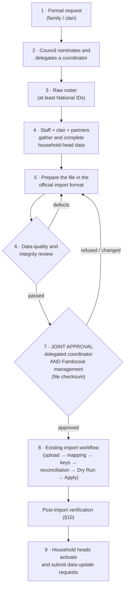

# FB-GOV-01 — Clan Onboarding & Initial Data Governance

| | |
|---|---|
| Status | **Governance procedure — documentation only.** The onboarding workflow (§2) and the joint-approval rule (§8) are **approved by the product owner (2026-10-22)** as Famboook operating procedure. **This is not a legal approval**: it does not establish a legal basis for processing, record any consent, or create any agreement with a partner institution (§3, §15) |
| Date | 2026-10-22 |
| Baseline | HEAD `e0f8fa5`. No backend, frontend, database, RBAC or import behaviour is changed by this document |
| Operator | PCDCD — legal operator and data management authority (FB-LEGAL-01 D1) |
| Related | `docs/decisions/FB-LEGAL-01-DECISIONS.md` (D1 approved; D2–D9 pending; D10 recorded with this document); `docs/audits/FB-LEGAL-01A-AUDIT.md`; docs/03 §96a–§96b (Import Wizard, Apply); docs/06 §61 (import permissions), §56a (clan structure); docs/08 §7a (Import Apply activation); docs/03 coordinator rules (scope ~L2593–2650, CO-02 requests ~L2652–2716) |

Labels:
- **[SYSTEM]** enforced by the application today (citation given);
- **[PROCEDURE]** a governance control carried out by people, outside the application;
- **[GAP]** the application does not support the control; listed in §14, never implemented by this document.

---

## 1. Purpose and scope

This document governs how a family or clan (العائلة / العشيرة) joins Famboook: the request, the delegation of a coordinator, the collection and preparation of the initial household-head data, the joint approval of the import file, the import itself, and the household heads' later access through the Family Portal.

It does **not** cover:
- Staff registration of individual families (`/families/new`);
- incremental imports;
- coordinator change requests after onboarding (CO-02);
- the legal content of the privacy policy and the other legal pages (FB-LEGAL-01, pending).

**Definitions**

| Term | Meaning in this document |
|---|---|
| Clan (عشيرة / عائلة كبيرة) | The structure registered as a Clan in Famboook (`clans`, with branch groups and branches; docs/06 §56a) |
| Family / clan council | The body the clan itself recognises as entitled to decide for it. Famboook does not define or verify its composition (§15 G-02) |
| Delegated coordinator | The person the council nominates and delegates to act for the clan in onboarding and, later, in Coordinator Space |
| Raw roster | The list the clan submits (at least National IDs). Source evidence only — **never the import file** |
| Prepared import file | The workbook built from the roster and other sources in the official import format (§7) |
| Jointly approved file | The prepared import file, identified by its SHA-256 checksum, approved by both the delegated coordinator and Famboook management (§8) |
| Partner institution | An organisation that contributes or confirms data during preparation (§6). No agreement with any partner is recorded in the repository |
| Famboook management | The operator's management (PCDCD) acting for Famboook. Who signs is named per onboarding (§15 G-05) |

## 2. Approved onboarding workflow

The exact sequence, approved 2026-10-22:

1. A family or clan formally requests to use Famboook.
2. Its agreed family/clan council nominates and delegates a coordinator.
3. The family/clan submits an initial roster containing at least national identification numbers.
4. Famboook staff collaborate with the clan and relevant partner institutions to gather and complete initial household-head data.
5. The collected data are prepared in the official Famboook Excel import template, matching its required columns and validation rules.
6. The prepared file undergoes data-quality and integrity review.
7. **Both the formally delegated clan coordinator and Famboook management approve the final import file.**
8. Only the jointly approved, validated file proceeds to the existing import workflow.
9. Household heads subsequently access the family portal through the established activation process and can submit data-update requests.

**The raw clan roster must not be treated as the final import file.** It is source evidence for step 4. Only the file approved at step 7, unchanged (same checksum), may be uploaded at step 8.

### 2.1 Workflow diagram



The raw roster (step 3) never enters step 8 directly. A file changed after step 7 has a new checksum and returns to step 6.

### 2.2 The same flow as text

```text
request ─► delegation ─► raw roster ─► data gathering ─► prepared file ─► QA review ─┬─► JOINT APPROVAL ─► import workflow ─► verification ─► portal access
                                                              ▲                     │        │
                                                              └──── defects ────────┘        └─ refused / file changed ─► back to preparation
```

## 3. Legal boundaries — four different approvals

Each approval below is separate. None of them implies another, and none is a legal basis for processing.

| # | Approval | Given by | It authorizes | It does **not** authorize |
|---|---|---|---|---|
| A | **Clan participation** (step 1) | The family / clan | Famboook to start onboarding with this clan | Processing any individual's personal data; any member's consent |
| B | **Coordinator delegation** (step 2) | The family / clan council | The named person to represent the clan in onboarding (and, when granted in the system, to act in Coordinator Space within the scope Staff assign) | Speaking for every member's privacy rights; approving data beyond onboarding; any system permission by itself — the system role is granted separately by Staff (§5) |
| C | **Import file approval** (step 7) | The delegated coordinator **and** Famboook management | That the identified file is complete and correct as prepared, and may enter the import workflow | Consent of the people in the file; sensitive-data processing; publication of any data |
| D | **Individual consent or another legal basis** | Each data subject (or as applicable law provides), as decided under FB-LEGAL-01 D3 | Processing of that person's personal data on the basis PCDCD decides | — |

**Rules:**
- **No group approval covers individuals.** Clan participation (A), delegation (B) and file approval (C) do not automatically authorize processing of every member's personal or sensitive data. The applicable legal basis (D) is **undecided** (FB-LEGAL-01 D3, PENDING). Until it is decided, this document records no consent and claims none.
- **No consent mechanism exists in Famboook today** (FB-LEGAL-01A §1, §3). Any consent obtained during onboarding is off-system, and its evidence format is an open decision (§15 G-01).
- **Sensitive categories are not part of the initial import.** The import format carries no health, disability or document data (§7.1). Adding any sensitive category to onboarding needs its own decision (§15 G-09).

## 4. Roles and responsibilities

### 4.1 Responsibilities

| Party | Responsibilities |
|---|---|
| **Family / clan council** | Decide to request participation; nominate and formally delegate the coordinator in writing; define the delegation's scope (the whole clan, or named branches); replace or withdraw the coordinator and inform Famboook; provide or facilitate the raw roster |
| **Delegated coordinator** | Represent the clan in onboarding; help Staff complete household-head data; review the prepared file with Staff; approve or refuse it (step 7); after onboarding, act only within the scope Staff assign in the system (§5) |
| **Famboook management (PCDCD)** | Accept the clan's request; verify the delegation evidence; designate the Staff who prepare and import; approve or refuse the prepared file (step 7); authorize the import; own the onboarding record (§8.3); decide pending legal questions (§15) |
| **Famboook Staff** | Collect and complete data with the clan and partners; prepare the file in the official format; run the data-quality review; keep the provenance record; perform the import (SUPER_ADMIN only, §9); verify the result (§10) |
| **Partner institutions** | Contribute or confirm data only within an agreement or arrangement that PCDCD approves (none recorded, §15 G-03) |
| **Household heads** | After import: activate their account and request corrections through the Family Portal (step 9) |

### 4.2 Responsibility matrix (RACI)

R = responsible (does it) · A = accountable (approves / owns) · C = consulted · I = informed

| Step | Council | Coordinator | Management | Staff | Partners | Household heads |
|---|---|---|---|---|---|---|
| 1 Formal request | R | — | A | I | — | — |
| 2 Delegation | A / R | I | C (verifies evidence) | I | — | — |
| 3 Raw roster | A | R | I | C | — | — |
| 4 Data gathering | C | C | A | R | C | — |
| 5 File preparation | — | C | A | R | — | — |
| 6 Quality review | — | C | A | R | — | — |
| 7 **Joint approval** | I | **A (co-approver)** | **A (co-approver)** | R (prepares evidence) | — | — |
| 8 Import | I | I | A (authorizes) | R (SUPER_ADMIN) | — | — |
| Post-import verification | — | C | A | R | — | — |
| 9 Portal access | — | I | I | C (support) | — | R |

## 5. Coordinator delegation and scope of authority

**Delegation [PROCEDURE].**
- The council delegates the coordinator **in writing**: name, the clan (and branches, if limited), the date, and the council's signatories.
- Management verifies the delegation before step 3 proceeds.
- The system has **no field** for the council, the delegation document or the delegating authority **[GAP G-A]**. The evidence is kept in the onboarding record (§8.3).

**The coordinator's system role comes later, by design [SYSTEM].**
- The role can be granted only to an **existing, activated household-head family account**: an active Staff account with `coordinator-scope.manage` (SUPER_ADMIN, ADMINISTRATOR) grants it (`backend/app/Actions/GrantCoordinatorRoleAction.php`; eligibility in `Support/FamilyAuth/Coordinators.php`).
- Activation needs the person in the registry (§11).

**Consequences:**
- During steps 2–7 the coordinator **has no Famboook account**. Their approval at step 7 is necessarily **off-system** (§8).
- After import, once their own household is imported and activated, Staff may grant the role and assign a scope (CLAN, BRANCH_GROUP or BRANCH; `AssignCoordinatorScopeAction.php`). That is a separate Staff action, with its own audit events `COORDINATOR_ROLE_GRANTED` and `COORDINATOR_SCOPE_ASSIGNED` in `auth_security_events`.
- **The scope assigned must not exceed the council's written delegation [PROCEDURE].**

**Scope of authority in the system [SYSTEM]** (seeder COORDINATOR role; docs/03 coordinator rules; docs/06 ~L636–668):
- **Can:**
  - see the families of the current scope (summaries; masked values; one audited reveal per field);
  - submit proposals — REGISTER_FAMILY and ADD_FAMILY_MEMBER (CO-02, gated by `CHANGE_REQUESTS_COORDINATOR_SUBMISSION_MODE`, default OFF);
  - send announcements and follow-ups when notifications are enabled.
- **Cannot:**
  - any import (`import.*` is SUPER_ADMIN only);
  - edit the registry directly;
  - approve or review requests;
  - grant verification;
  - act outside the scope.
- **Proposals are only proposals.** A coordinator proposal changes nothing until Staff review and apply it, and the reviewer, not the coordinator, records the attestations.

**Replacement and withdrawal [PROCEDURE + SYSTEM].**
- When the council replaces or withdraws the coordinator, Staff revoke the scope and, if appropriate, the role. The revocation reasons are ADMINISTRATIVE, NO_LONGER_ELIGIBLE, SCOPE_CHANGED or ROLE_REMOVED, with audit events `COORDINATOR_SCOPE_REVOKED` and `COORDINATOR_ROLE_REVOKED`.
- An assignment never expires on its own (docs/08 §16a).
- The revocation reasons don't include "the council withdrew the delegation"; ADMINISTRATIVE is used and the evidence goes in the onboarding record **[GAP G-B]**.

## 6. Collaboration with partner institutions and source-data provenance

**Partners [PROCEDURE].**
- Data from a partner institution may be used only under an arrangement PCDCD approves, stating what is shared, for what purpose, and how it is protected.
- **No such arrangement is recorded in the repository**, and none is assumed by this document (§15 G-03).
- Partners receive no Famboook access through onboarding.

**Provenance record [PROCEDURE].** For every prepared file, Staff record, per data element or column:
- the source: raw roster, clan-supplied correction, partner institution (named), existing paper form, or Staff verification;
- the date obtained;
- who obtained it.

The record is part of the onboarding record (§8.3).

**What the system records [SYSTEM]:**
- **The batch:** `import_batches` stores `source_filename`, `source_checksum` (SHA-256), `source_size_bytes`, `uploaded_by`, the Clan, `reconciled_by` and `applied_by` (`backend/app/Support/Import/ImportBatchWorkbook.php`; docs/02 ~L3849–3871).
- **Records created by the import:**
  - families get `registration_source = IMPORT`;
  - household declarations and residences get `source = IMPORT`;
  - each created row is tied to its batch and source row in `import_apply_records` (append-only);
  - the family activity log records `FAMILY_IMPORTED` with the batch and row number.

**What the system does not record [GAP G-C]:**
- which partner institution or source supplied a value — there is no partner or institution field;
- per-person source: `persons` has no source column, and a person's provenance exists only through `import_apply_records`;
- the clan's approval or the delegation.

These stay in the onboarding record.

## 7. Excel preparation and validation

### 7.1 The official import format

**There is no template workbook file in the repository [GAP G-D].** The official format is defined by:
- the approved column mapping in docs/03 §96a (~L3631–3719);
- `backend/app/Support/Import/InitialFamilyWorkbook.php`.

Columns are mapped by position in the wizard, and header text only suggests the mapping. Header row = row 1.

| Column (Arabic header) | Maps to | Required |
|---|---|---|
| المفتاح | family key (`source_family_key`) → resolved to a Branch | **Yes** |
| رقم الهوية | head National ID | **Yes** |
| الاسم | head full name | **Yes** |
| الميلاد | birth date | No |
| الجنس | gender (ذكر / أنثى / انثى) | No |
| الحالة الاجتماعية | marital status (fixed list; متعدد الزوجات → MARRIED with the polygamy rule) | No |
| المدينة | original residence (city only) | No |
| حالة الوفاة / الوفاة | life status (حي، حية، متوفى، متوفي، متوفاة) / death date | No |
| أفراد الأسرة، أبناء ذكور أحياء، أبناء إناث أحياء | household declaration counts | No |
| الجوال | head mobile | No |
| هوية الزوجة / الزوجة (up to 4) | spouse National ID / name → spouse membership | No |

- **Never stored or mappable:** هويتك and الديانة (`backend/app/Support/ImportRawPayload.php`; docs/03 ~L3338–3341).
- **The format contains no health, disability or document data.**

### 7.2 Validation the system performs [SYSTEM]

| Stage | Checks | Source |
|---|---|---|
| Upload | `.xlsx` only, ≤ 10 MB; the Clan and the import mode are explicit; ≤ 20,000 data rows; one plausible sheet or the administrator chooses; the same file (SHA-256) for the same Clan is refused while an earlier batch of it is not FAILED | `CreateImportBatchRequest.php`; `InitialFamilyWorkbook.php`; `ImportBatchWorkbook.php` |
| Staging | rejects cell errors and extra cells; flags a missing, formula or over-long (> 150) family key, and a missing name; count columns accept 1–5 digits only | `InitialFamilyRow.php` |
| Reconciliation | exact National ID matching only (never by name). Conflicts: head ID equals spouse ID, several registry persons, an existing person who is not a head, a family in another clan. Duplicates in the file. Cases needing review: format variants, deleted-person match, identity mismatch, unmapped values, life-status inconsistencies, shared spouses | `ImportReconciler.php` |
| Dry Run | National ID must be exactly 9 digits and not nine identical digits (**no check-digit rule**); a head without an ID or name; duplicate or ambiguous heads; a head with an active membership; invalid death data; an unresolved family key or branch; declaration counts out of range; every row must be NEW | `Apply/ImportApplyPlanner.php`; `RegistryNationalId.php` |

### 7.3 Data-quality and integrity review (step 6) [PROCEDURE]

Before step 7, Staff confirm and record:

1. The file is in the official format (§7.1), with no column outside it, and هويتك and الديانة are absent.
2. **National IDs are stored as text with 9 digits.** A number cell loses a leading zero and the row then blocks (docs/03 ~L3699–3703).
3. **Mobile numbers follow the portal format `05` + 8 digits.** The import does **not** validate mobiles **[GAP G-E]**; a malformed mobile is imported but makes activation impossible (`FamilyAuth/FamilyMobile.php`).
4. **Birth dates are well-formed.** No explicit birth-date format check was found at import **[GAP G-F]**.
5. **Life status is filled for every head.** A blank becomes UNKNOWN, and an UNKNOWN head cannot activate until Staff confirm them alive (docs/11 ~L5277).
6. Each household appears once (one head ID per family); spouses reference the head consistently.
7. Every value traces to the provenance record (§6), and nothing comes from the raw roster without verification.
8. **A trial run on a non-Production environment, if available,** shows no blocking issue in staging, reconciliation or the Dry Run. The Dry Run on Production is part of step 8 and must also be clean.

Defects return the file to step 5. The reviewed file's SHA-256 checksum is computed and recorded.

## 8. Joint approval and evidence (step 7)

### 8.1 Rule

The import file is approved only when **both** of these approve the **same file**, identified by its SHA-256 checksum:
- the **formally delegated clan coordinator**;
- **Famboook management**.

- **Either party may refuse.** A refusal or any change to the file voids the approval; a changed file has a new checksum and returns to step 6.
- **Approval is of the file's content as prepared.** It is not consent of the people in it (§3).

### 8.2 What is approved

| Item | Value recorded |
|---|---|
| Clan | name and code |
| File | file name, SHA-256 checksum, size, data-row count, number of households |
| Review | the date of the quality review (§7.3) and the reviewer |
| Known exceptions | rows deliberately excluded, with the reason (no personal values in the approval record) |
| Coordinator approval | name, the delegation it relies on (§5), date, signature |
| Management approval | name, role, date, signature |

### 8.3 The onboarding record [PROCEDURE]

One record per clan onboarding, kept by Famboook management outside the application:
- the formal request (step 1);
- the written delegation (step 2);
- the receipt of the raw roster (step 3; date, format, who handed it over);
- the provenance record (§6);
- the quality review (§7.3);
- the joint approval (§8.2);
- the import authorization and its result (§9, §10).

**Where and for how long** it is kept, and who may access it, is open (§15 G-04, G-06). **It must not contain the data itself:** the file is referenced by its checksum, not copied into the record.

### 8.4 Link to the system

- The approved checksum must equal `import_batches.source_checksum` of the batch that is applied. The system computes the checksum at upload; the approval does not exist in the system **[GAP G-G]**.
- Staff compare the two at step 8 and stop on any mismatch.

## 9. Import authorization and auditability (step 8)

| Control | State |
|---|---|
| Who may import | `import.upload`, `.validate` and `.review` belong to SUPER_ADMIN only; `import.apply` is SUPER_ADMIN only, through the gated permissions [SYSTEM] (`RolePermissionSeeder.php`; docs/06 §61) |
| Apply gate | `IMPORT_APPLY_ENABLED`, default false (`backend/config/import.php`); verified by `famboook:verify-permissions`. Opening it in Production follows docs/08 §7a and is a **separate approval** [SYSTEM + PROCEDURE] |
| Precondition | only a **jointly approved** file whose checksum matches (§8.4) may be uploaded [PROCEDURE] |
| Wizard | Clan and mode → upload and inspect → column mapping → family keys → review and reconciliation → Dry Run → Apply (docs/03 §96a–§96b) [SYSTEM] |
| Audit | `import_batches` (who uploaded, reconciled and applied, and when), family-key resolutions (who resolved them and when), `import_apply_records` (append-only, one per row and effect), `FAMILY_IMPORTED` in the family activity log. Logs carry codes only [SYSTEM]. Who confirmed the mapping is not recorded **[GAP G-H]** |
| Idempotency | each row in its own transaction; Apply resumes after interruption; an APPLIED batch is re-verified, never re-run [SYSTEM] |
| Reversal | **none.** There is no automatic rollback of created records, and Branches created during import are never deleted (docs/03 ~L4095, ~L3593–3609) [SYSTEM]. Errors are corrected forward (§10) |
| Open item | PWF-024 "Exact import approval workflow" is open (docs/05 ~L3474). This document proposes §8 as that workflow; closing PWF-024 is a decision (§15 G-07) |

## 10. Post-import verification and corrections

**Verification [PROCEDURE], within an agreed period after Apply:**
- the batch is APPLIED (not PARTIALLY_APPLIED);
- the created households match the approved count;
- a sample of households is checked against the approved file by Staff;
- the coordinator confirms the household list for the clan, without receiving any data beyond what Coordinator Space shows them.

The result goes into the onboarding record.

**Corrections [SYSTEM]:**
- Staff correct registry data through the existing permissioned screens.
- After activation, household heads request corrections through change requests (PERSON_CORRECTION, RESIDENCE_UPDATE, DEATH_REPORT, ADD_FAMILY_MEMBER, CONTACT_UPDATE), each behind its gate. Staff review and apply them.
- A coordinator may propose REGISTER_FAMILY or ADD_FAMILY_MEMBER when CO-02 is enabled.

There is no rollback (§9).

**Known post-import effects to plan for [SYSTEM]:**
- Imported mobiles start unverified; activation by SMS code verifies them.
- Spouses are created with life status UNKNOWN, and so is a head with a blank life-status cell.
- A malformed mobile blocks activation until it is corrected (§7.3).

## 11. Household-head portal access (step 9)

Prerequisites [SYSTEM] (docs/03 ~L2754–2760, ~L2816–2832; docs/11):
- the household head's National ID matches exactly one person;
- the head is alive (UNKNOWN is not eligible), with an active membership in an ACTIVE family;
- there is a valid current mobile number that Staff have not revoked;
- no account exists yet;
- the activation gate `FAMILY_ACTIVATION_ENABLED` is open (default false); login and password reset have their own gates.

**Data-update requests** need `CHANGE_REQUESTS_FAMILY_SUBMISSION_MODE` (OFF / PILOT / GENERAL, default OFF). CONTACT_UPDATE also needs `FAMILY_CONTACT_UPDATE_ENABLED`.

Opening any of these for a newly onboarded clan follows the existing deployment approvals (docs/08). It is not implied by the joint approval.

## 12. Privacy, confidentiality and access-control principles

1. **Minimum data.** The raw roster needs no more than the National IDs and the data required by the official format. Columns outside the format (§7.1) are not collected for the import, and هويتك and الديانة are never stored [PROCEDURE + SYSTEM].
2. **No sensitive categories in onboarding.** Health, disability and identity documents are not part of the initial import (§3) [PROCEDURE].
3. **Need-to-know.** Only the designated Staff handle rosters and prepared files. Coordinators see only what Coordinator Space shows, with masked values and audited reveals, and have no import access [SYSTEM + PROCEDURE].
4. **Separation of duties.** The coordinator and management co-approve; Staff prepare; only SUPER_ADMIN imports; the Apply gate is a separate approval [PROCEDURE + SYSTEM].
5. **Secure handling.** Rosters and prepared files are kept and transferred only through channels PCDCD approves, are never sent through public or personal messaging accounts, and are deleted or archived per the retention decision. **Approved channels and the retention period are open** (§15 G-04, G-08) [PROCEDURE].
6. **The record stays out of the data.** Approval and onboarding records reference files by checksum, not by content (§8.3) [PROCEDURE].
7. **Retention is undecided.** Uploaded workbooks and import staging rows (which hold plaintext National IDs and mobiles) are kept indefinitely today, with no purge. Workbook files are not included in database backups (FB-LEGAL-01A §4, M3; PDD-017 open; FB-LEGAL-01 D4 pending) [GAP G-I].
8. **Truthful statements only.** Nothing in onboarding communication may promise retention, deletion, consent handling or security measures that are not implemented or decided (FB-LEGAL-01 decision register) [PROCEDURE].

## 13. Approval checkpoints

| CP | When | Decision | Approver | Evidence (onboarding record) | Stop if |
|---|---|---|---|---|---|
| CP1 | Step 1 | Clan request accepted | Famboook management | written request, acceptance | not accepted |
| CP2 | Step 2 | Delegation verified | Famboook management | council's written delegation | missing or unclear delegation |
| CP3 | Step 3 | Roster received | Staff (receipt), management (I) | receipt: date, format, channel | roster arrives through an unapproved channel |
| CP4 | Step 6 | Quality review passed | Staff reviewer | §7.3 checklist, file checksum | any checklist item fails |
| CP5 | Step 7 | **Joint approval** | **Delegated coordinator AND Famboook management** | §8.2 approval with the checksum | either refuses; the file changed |
| CP6 | Step 8 | Import authorized | Famboook management; Apply gate per docs/08 §7a | authorization; batch checksum equals the approved checksum | checksum mismatch; Dry Run not clean; gate not approved |
| CP7 | After Apply | Import verified | Staff (R), management (A), coordinator (C) | §10 verification result | count mismatch; PARTIALLY_APPLIED |

## 14. Existing implementation versus governance controls

| Control | Today | Gap |
|---|---|---|
| Clan request and participation | not in the system (clans have only code, name and active flag) | G-A: no onboarding status, agreement or request record — procedure only |
| Council delegation | not in the system; the coordinator role needs an activated head, so it comes after import | G-A: no delegation field or document reference |
| Coordinator withdrawal | revocation exists, with fixed reasons | G-B: no "delegation withdrawn" reason; ADMINISTRATIVE plus the record |
| Source provenance | batch-level file name, checksum, uploader; IMPORT source on families, declarations, residences; `import_apply_records` | G-C: no partner or institution field; no per-person source column |
| Official template | column mapping in docs and code | G-D: no distributable template workbook |
| Mobile validation | none at import; checked at activation | G-E |
| Birth-date validation | no explicit check found | G-F |
| National ID check digit | not implemented (9 digits, not all identical) | — (by design, docs/03) |
| Joint approval | not in the system | G-G: approval and checksum comparison are procedure only |
| Mapping confirmation audit | `mapping_confirmed_at` only | G-H: no `mapping_confirmed_by` |
| Import authorization | SUPER_ADMIN only; Apply gate default closed; verifier | — |
| Import audit trail | batch actors, key resolutions, append-only apply records, family activity | — |
| Reversal | none | — (correct forward, §10) |
| Staging and workbook retention | kept indefinitely; workbooks not backed up | G-I (D4 / PDD-017) |
| Consent or legal basis | none in the system | §15 G-01 (D3) |

These gaps are documented only. Closing any of them needs its own design and approval.

## 15. Unresolved decision register

| ID | Question | Linked | Owner | Status |
|---|---|---|---|---|
| G-01 | **Consent evidence and legal basis:** is individual consent required for onboarding data, or does another basis apply? If consent: from whom (each adult; guardians for minors), in what form, kept where? | FB-LEGAL-01 D3, D6 | PCDCD | PENDING |
| G-02 | **Council legitimacy:** what makes a council "agreed", and what written evidence of its decision and composition Famboook requires | — | PCDCD / management | PENDING |
| G-03 | **Partner data-sharing:** which partner institutions, under which written arrangements (purpose, data, protection, retention) | FB-LEGAL-01 D5 | PCDCD | PENDING — none recorded |
| G-04 | **Retention** of the raw roster, prepared files, uploaded workbooks, import staging rows and the onboarding record; deletion method | FB-LEGAL-01 D4; PDD-017 | PCDCD | PENDING |
| G-05 | **Who signs for Famboook management** at CP1, CP2, CP5 and CP6, and the delegation of that authority | — | PCDCD | PENDING |
| G-06 | **Onboarding-record custody:** storage location, access, format (paper or electronic), and whether any part later moves into the system | — | PCDCD | PENDING |
| G-07 | **Close PWF-024** by adopting §8 as the import approval workflow, or amend it | docs/05 PWF-024 | Product owner | PENDING |
| G-08 | **Approved transfer channels** for rosters and files between the clan, partners and Staff | — | PCDCD | PENDING |
| G-09 | **Sensitive categories:** whether any health, disability or child-specific data may ever be collected during onboarding, and on what basis | FB-LEGAL-01 D3, D6, D8 | PCDCD | PENDING |
| G-10 | **Applicable law** governing onboarding data and the council's role | FB-LEGAL-01 D3 | PCDCD | PENDING |
| G-11 | **Withdrawal of a clan** after import: what happens to imported data and accounts (no deletion path exists) | FB-LEGAL-01 D4, D6 | PCDCD | PENDING |
| G-12 | **System support for the gaps** G-A … G-I (template workbook, mobile and birth-date validation, delegation and approval records, provenance fields) — whether to build them | §14 | Product owner | PENDING — not part of this document |

**G-02 — `/terms` disposition note (FB-LEGAL-G02-DISPOSITION-01, 2026-10-22).** The Executive Director, PCDCD, has accepted G-02 as **OPEN for `/terms` publication readiness only** (`docs/decisions/FB-LEGAL-01-DECISIONS.md` §1.1). The underlying governance requirements in the G-02 row remain **unresolved** and its status above stays PENDING. The decision is **not** proof of council agreement, membership, composition or delegation, and the required governance work remains pending. No other use of this decision, for other pages, policies, onboarding approvals or imports, is automatically authorized.

## 16. Change log

| Date | Change |
|---|---|
| 2026-10-22 | Created. Workflow (§2) and joint approval (§8) recorded as approved operating procedure; legal questions open (§15); implementation gaps documented (§14), nothing implemented |
| 2026-10-22 | FB-LEGAL-G02-DISPOSITION-01: `/terms`-only disposition note added under §15 (G-02 accepted as open for `/terms` publication readiness only). G-02 status unchanged (PENDING / open) |
